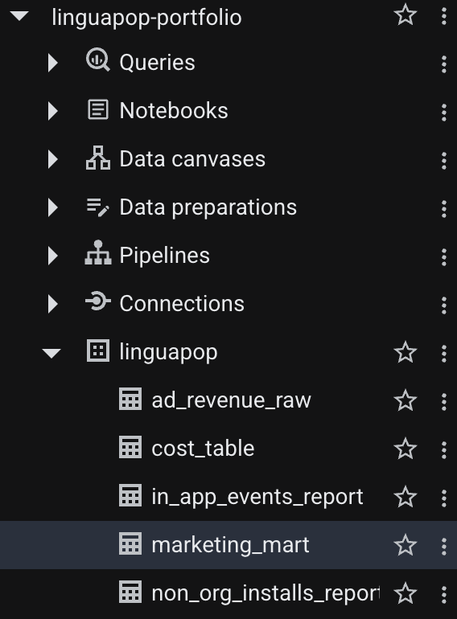
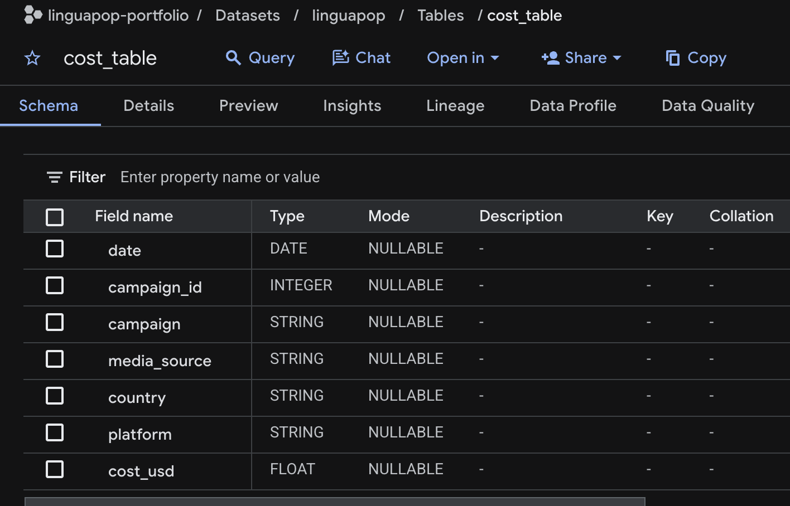
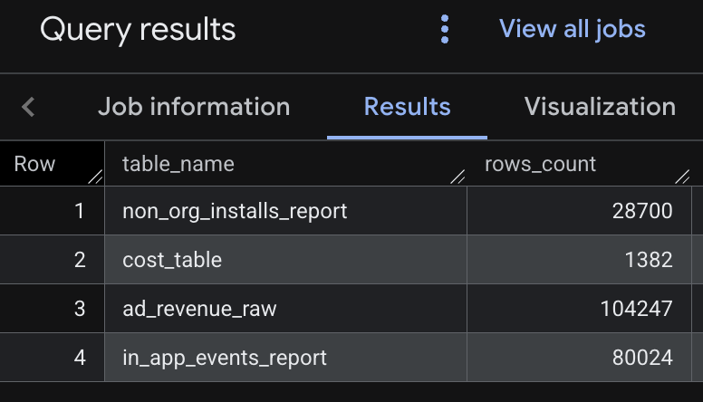
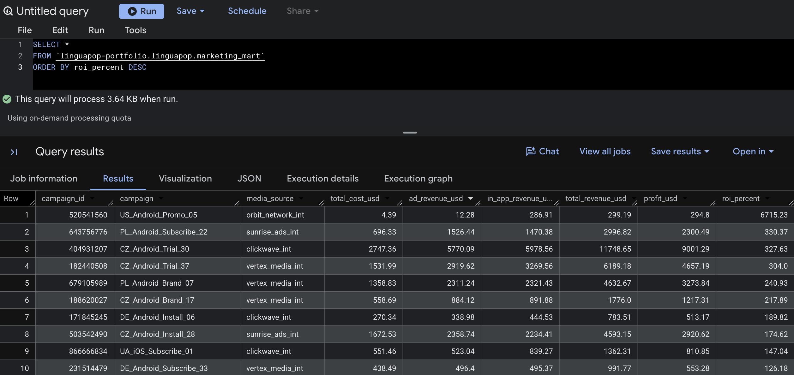
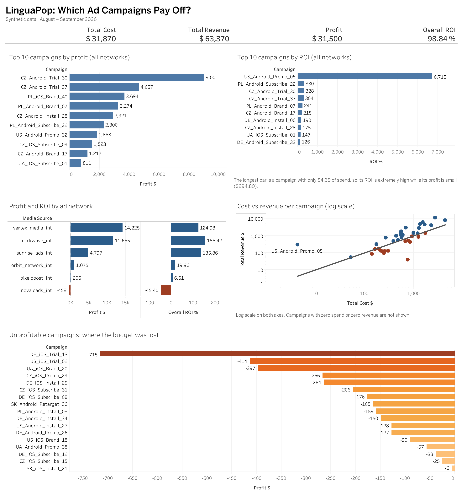

# LinguaPop Marketing Mart

## About the Project

LinguaPop is a fictional mobile app for learning foreign languages. The company buys paid traffic: it pays ad networks for app installs. To understand which campaigns pay off and which waste budget, it needs a marketing mart: a single table that brings together ad spend and the revenue those campaigns generated.

Right now this data sits in four separate tables that are not connected to each other.

## Tasks

1. Join the four tables and build a marketing mart at the ad campaign level.
2. Use the mart to determine which campaigns pay off and which do not (Profit, ROI).
3. Build a Tableau dashboard with several visualizations.

## Data

All data is synthetic and was created for this learning project. The task logic is inspired by a real-world assignment, but no data from a real company was used. Period: August – September 2026.

| Table | Contents |
|---|---|
| `cost_table` | Ad spend |
| `ad_revenue_raw` | In-app ad revenue (free version) |
| `in_app_events_report` | Subscriptions, purchases and related events |
| `non_org_installs_report` | App installs from ad sources |

The tables were loaded into Google BigQuery (Sandbox) from CSV files. The dataset contains the four source tables and the resulting `marketing_mart` table.






## Tools

Google BigQuery (Sandbox), SQL, Tableau Public, GitHub.

## Process

### 1. Data exploration

I started by reviewing all four tables and their structure to understand what each source contains and which fields can be used to join them. I then checked the time period: all four tables cover **1 August – 30 September 2026**, so the data can be combined consistently.

The common key is `campaign_id`, the unique identifier of an ad campaign. The `non_org_installs_report` table was reviewed but not used in the mart, since installs are not needed to calculate revenue, profit and ROI.

After loading, I checked that all rows were uploaded correctly:



### 2. Mart structure

The mart is built at the level of a single ad campaign: one row = one campaign (`cost_table` contains 40 unique campaigns). It includes:

- **Campaign ID**: campaign identifier
- **Campaign**: campaign name
- **Media Source**: traffic source
- **Total Cost**: total ad spend
- **Ad Revenue**: revenue from in-app ads
- **In-App Revenue**: revenue from in-app events (purchases, subscriptions)
- **Total Revenue**: total revenue of the campaign
- **Profit**: campaign profit
- **ROI**: return on ad spend

### 3. Aggregation before joining

To get correct results, I first aggregated spend and each revenue type separately at the `campaign_id` level, and only then joined them. This prevents rows from being duplicated: a campaign has many revenue rows, and joining raw tables would multiply them.

### 4. Joining the tables

`cost_table` is the base table, because it holds ad spend and the full list of campaigns. I joined revenue with `LEFT JOIN`, which keeps every campaign even if one of the revenue types is missing.

Before calculating the metrics, I checked how complete the revenue data is for each of the 40 campaigns:

- 5 campaigns have no Ad Revenue;
- 9 campaigns have no In-App Revenue;
- 2 campaigns have no revenue of either type (these are included in both counts above).

For missing values I used `COALESCE(..., 0)`: if a campaign has no record for a given revenue type, it is counted as 0 instead of NULL, and the campaign stays in the result.

### 5. Calculating the metrics

After joining the data at the campaign level, I calculated the main financial metrics that show how effective each campaign is.

The snippets below are simplified for readability; the full query is in [`sql/marketing_mart.sql`](sql/marketing_mart.sql).

**Total Cost** is the total ad spend of a campaign: the sum of all `cost_usd` values for a given `campaign_id`. If a campaign had several records in `cost_table`, all of its spend is summed into a single value.

```sql
SUM(cost_usd) AS total_cost_usd
```

**Ad Revenue** is revenue earned from in-app ads: the sum of `event_revenue_usd` from `ad_revenue_raw` for each campaign.

```sql
SUM(event_revenue_usd) AS ad_revenue_usd
```

**In-App Revenue** is revenue from in-app events such as purchases and subscriptions: the sum of `event_revenue_usd` from `in_app_events_report` for each campaign.

```sql
SUM(event_revenue_usd) AS in_app_revenue_usd
```

**Total Revenue** is the total revenue a campaign brought in from both sources: `Total Revenue = Ad Revenue + In-App Revenue`. I used `COALESCE(..., 0)` so that a missing revenue source counts as 0 rather than NULL.

```sql
COALESCE(ad_revenue_usd, 0) + COALESCE(in_app_revenue_usd, 0) AS total_revenue_usd
```

**Profit** is the financial result of a campaign after ad spend: `Profit = Total Revenue − Total Cost`. A positive value means the campaign earned more than it cost; a negative value means it lost money.

```sql
COALESCE(ad_revenue_usd, 0) + COALESCE(in_app_revenue_usd, 0) - total_cost_usd AS profit_usd
```

**ROI** (Return on Investment) shows how profitable ad spend was relative to its size: `ROI = (Profit / Total Cost) × 100%`. I used `SAFE_DIVIDE` so that a campaign with zero spend returns NULL instead of causing a division-by-zero error.

```sql
SAFE_DIVIDE(profit_usd, total_cost_usd) * 100 AS roi_percent
```

ROI measures efficiency, not the absolute size of the profit. That is why a campaign with very low spend can have an extremely high ROI. In this data, one campaign spent only $4.39 and earned a $294.80 profit, which gives an ROI of about 6,715%, while campaigns with spend in the thousands of dollars have a much lower ROI but a far larger absolute profit. For this reason, ROI should always be read together with Profit and Total Cost.

Result of the mart query in BigQuery (40 rows, one per campaign):



## Data Checks

After building the mart, I checked the results to make sure the join and the calculated metrics are correct.

**No duplicate campaigns.** The final mart has 40 rows and 40 unique `campaign_id` values, which matches the number of unique campaigns in `cost_table`. This confirms that campaigns are not duplicated after the join. Since spend is grouped by `campaign_id`, `campaign` and `media_source`, it also confirms that no `campaign_id` has several campaign names or media sources.

**Unprofitable campaigns.** After calculating Profit, I identified campaigns with a negative result: 17 out of 40 campaigns are unprofitable. The largest loss is -$715.33.

**Consistency of totals.** Across the whole mart:

- Total Cost: $31,870.25
- Total Revenue: $63,369.84
- Profit: $31,499.59
- Overall ROI: 98.84%

Total Profit equals the difference between Total Revenue and Total Cost: $63,369.84 − $31,870.25 = $31,499.59. Overall ROI is calculated on the totals, not as an average of campaign ROIs: $31,499.59 / $31,870.25 × 100 ≈ 98.84%. The key financial metrics are therefore consistent with each other.

**Very high ROI.** One campaign has an ROI of about 6,715%. Such values appear when spend is very small compared to revenue (here, $4.39 of spend and a $294.80 profit). A high ROI does not necessarily mean the largest absolute profit.

## Dashboard

[Open the interactive dashboard on Tableau Public](https://public.tableau.com/app/profile/inna.bieliai/viz/Linguapopmarketing1111/LinguaPopMarketingDashboard)



The dashboard answers one question: which ad campaigns pay off? It contains:

- **KPI row:** Total Cost, Total Revenue, Profit and Overall ROI.
- **Top 10 campaigns by profit and by ROI:** two rankings, because the largest profit and the best return per dollar are different things.
- **Profit and ROI by ad network:** which networks earn money and which lose it.
- **Cost vs revenue per campaign:** every campaign on one chart (log scale); points above the line paid off.
- **Unprofitable campaigns:** all 17 campaigns with a negative result.

Clicking an ad network filters the KPI row, the scatter plot and the unprofitable campaigns.

## Key Findings

- **Advertising pays off overall.** $31,870.25 of spend brought $63,369.84 of revenue: a profit of $31,499.59 and an overall ROI of 98.84%.
- **But 17 of 40 campaigns lose money.** The largest loss is -$715.33 (`DE_iOS_Trial_13`). Two campaigns brought no revenue at all (ROI -100%).
- **Profit and ROI tell different stories.** The campaign with the highest ROI (about 6,715%) spent only $4.39 and earned $294.80, so it is not among the top 10 by profit. Both rankings should be read together.
- **Largest profit is not the best efficiency.** Vertex Media brings the most profit ($14,225), but Clickwave has the best ROI (156% vs. 125%): profit depends on budget size, ROI on return per dollar.
- **One network loses money.** Novaleads is negative (about -$458, ROI -45%): 4 of its 5 campaigns are unprofitable. Orbit Network and Pixelboost are technically profitable, but return very little per dollar (ROI 20% and 7%).
- **Platform pattern.** 11 of the 17 unprofitable campaigns run on iOS, while 7 of the top 10 campaigns by profit run on Android. Platform was read from campaign names; it is an observation, not proof of cause.

**Suggested next steps for the business (based on this data):** review or pause the most unprofitable iOS campaigns and Novaleads, and consider moving budget towards networks with a high ROI, while checking whether their results hold at larger spend.

## Data Limitations

- **Revenue without spend.** One `campaign_id` (108549135) appears in the revenue tables but has no record in `cost_table`. Its revenue totals $279.06 ($92.18 from ad revenue and $186.88 from in-app events), about 0.44% of the mart's Total Revenue. Because the mart starts from `cost_table`, this revenue is not included, and without spend data the campaign's profit and ROI cannot be calculated.
- **Organic revenue.** Rows with an empty `campaign_id` (9,329 in `ad_revenue_raw` and 9,123 in `in_app_events_report`) belong to users who did not come from an ad campaign. They were excluded on purpose, because they cannot be attributed to any campaign.
- **Zero spend.** One campaign has zero spend, so its ROI is NULL (division by zero is handled with `SAFE_DIVIDE`).
- **Synthetic data.** All findings describe this synthetic dataset only. Some patterns (for example, higher acquisition cost on iOS) were built into the data generation, so they illustrate the analysis method, not real market behaviour.

## Repository Structure

```text
linguapop-marketing-mart/
├── README.md
├── sql/
│   └── marketing_mart.sql        # full query that builds the mart
├── data/
│   ├── cost_table.csv            # ad spend (synthetic)
│   ├── ad_revenue_raw.csv        # in-app ad revenue (synthetic)
│   ├── in_app_events_report.csv  # subscriptions and purchases (synthetic)
│   ├── non_org_installs_report.csv  # installs from ad sources (synthetic)
│   └── marketing_mart.csv        # resulting mart, used in Tableau
└── screenshots/                  # BigQuery and dashboard screenshots
```
---

**Author:** Inna Bieliai · [LinkedIn](https://www.linkedin.com/in/inna-bieliai/) · [Tableau Public](https://public.tableau.com/app/profile/inna.bieliai)
